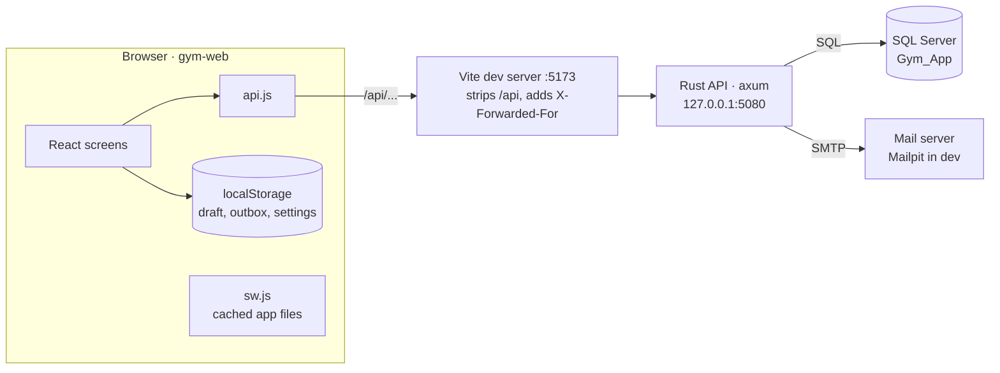
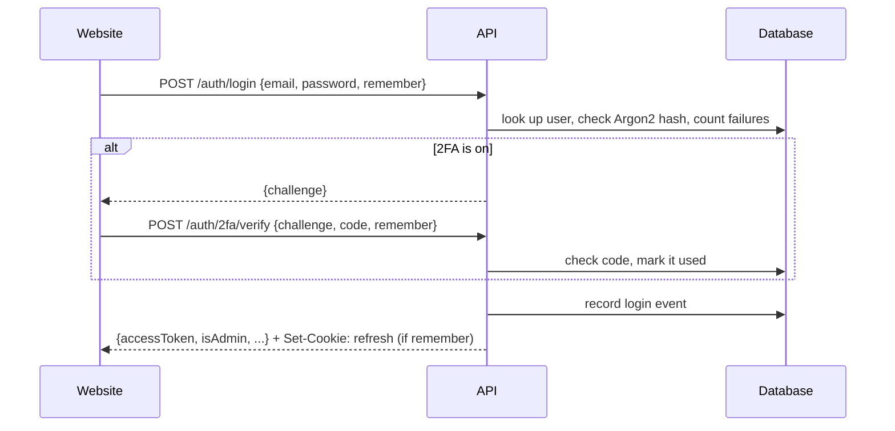
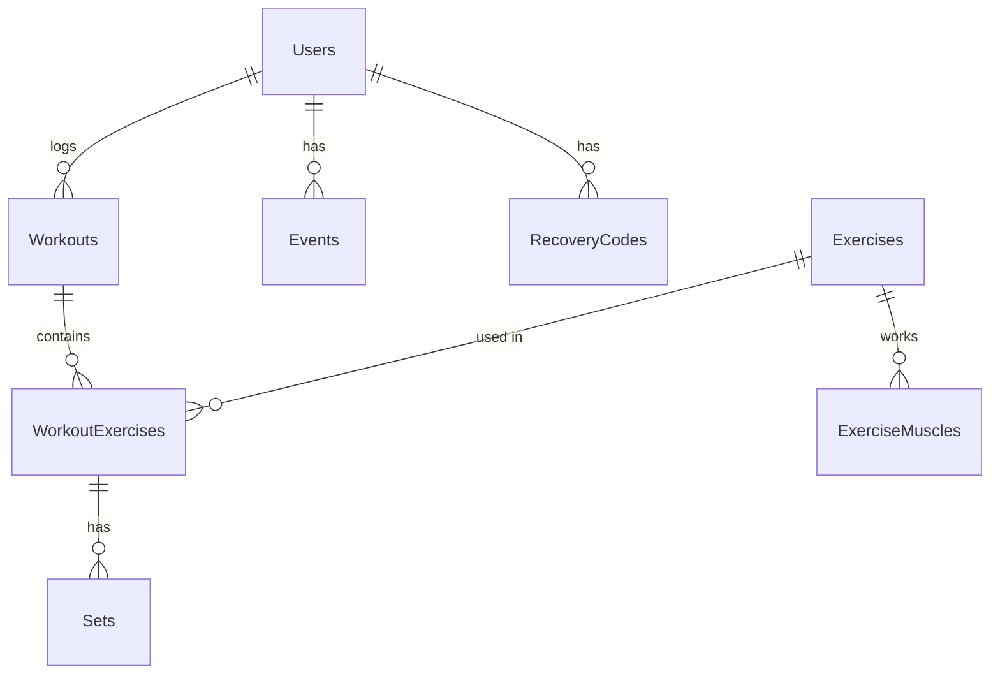

# BarMetric

A full-stack workout tracker for a gym's members. Members log workouts set by set (even with no signal), see which muscles they've trained, and work out which plates to load. Admins manage members and the shared exercise library.

- **gym-web/**: the website, React 19 + Vite
- **gym-api/**: the API, Rust + axum + Tokio
- **Database**: Microsoft SQL Server (via tiberius)

## Contents

- [Features](#features)
- [Getting started](#getting-started)
- [Configuration](#configuration)
- [Commands](#commands)
- [Deploying to Vercel](#deploying-to-vercel)
- [How it works](#how-it-works)
  - [Architecture](#architecture)
  - [Life of a request](#life-of-a-request)
  - [Signing in and tokens](#signing-in-and-tokens)
  - [Account flows](#account-flows)
  - [Security](#security)
  - [Data model](#data-model)
  - [Logging a workout](#logging-a-workout)
  - [Offline mode](#offline-mode)
  - [Muscle map, plate calculator and admin](#muscle-map-plate-calculator-and-admin)
  - [The website's structure](#the-websites-structure)
- [API reference](#api-reference)
- [Project structure](#project-structure)
- [Known limitations](#known-limitations)

## Features

**Members**

- Sign up with email confirmation, log in, "Stay logged in" for 30 days
- Two-factor authentication with an authenticator app, plus 10 one-time recovery codes
- Forgot password by email; change password; delete (deactivate) and reactivate your account
- Log a workout: search the exercise library, see last time's numbers for each exercise, tick sets as you go, optional RIR (reps in reserve), left/right sets for one-sided (unilateral) exercises, and notes
- Rest timer after each set, with a default you choose and −15s / +15s while resting
- Works offline: a workout in progress survives a refresh, and a finished workout waits on the phone until there's signal
- Workout history and a front/back muscle map of the last 30 days
- Plate calculator: the fewest plates per side for any weight

**Admins**

- List members with their login and workout counts; charts of logins and failed logins per day
- Make or remove admins, create password reset links, reactivate accounts
- Add, edit and delete exercises in the shared library

## Getting started

### Prerequisites

- [Rust](https://rustup.rs/) (stable, 2024 edition)
- [Node.js](https://nodejs.org/) 20+ and npm
- SQL Server: a local install, Azure SQL, or Docker:

  ```sh
  docker run -e "ACCEPT_EULA=Y" -e "MSSQL_SA_PASSWORD=<your-password>" \
    -p 1433:1433 -d mcr.microsoft.com/mssql/server:2022-latest
  ```

- A way to run SQL scripts: `sqlcmd`, Azure Data Studio, or SSMS
- For email in development, [Mailpit](https://mailpit.axllent.org/), which catches every email the app sends:

  ```sh
  docker run -d -p 8025:8025 -p 1025:1025 axllent/mailpit
  ```

  Its inbox is at http://localhost:8025. Confirmation and reset links appear there.

### 1. Clone

```sh
git clone https://github.com/jetthomas/gymapp.git
cd gymapp
```

### 2. Create the database and its tables

Create the database, then run [`gym-api/sql/schema.sql`](gym-api/sql/schema.sql) against it as the admin login:

```sql
CREATE DATABASE Gym_App;
```

`schema.sql` is the one place every table, column and index is defined. It skips whatever already exists, so run it again after pulling a change to it.

### 3. Configure the API

Create `gym-api/.env`. Until step 6, use an admin login such as `sa`:

```env
DB_HOST=localhost
DB_USER=sa
DB_PASSWORD=<your-password>
DB_TRUST_CERT=true
JWT_SECRET=<run: openssl rand -base64 48>
SMTP_HOST=localhost
SMTP_PORT=1025
MAIL_FROM=BarMetric <no-reply@localhost>
FRONTEND_URL=http://localhost:5173
STRIPE_KEY=<sk_test_... from the Stripe Dashboard>
STRIPE_PRICE_ID=<price_... of the Plus price>
STRIPE_WEBHOOK_SECRET=<whsec_... printed by stripe listen>
FOOD_USER_AGENT=BarMetric/1.0 (<your contact email>)
```

Never commit `.env`; it's already in `.gitignore`. Every setting is listed under [Configuration](#configuration).

### 4. Run the API

```sh
cd gym-api
cargo run
```

It checks it can reach SQL Server and stops with an error if it can't. Check it's up:

```sh
curl http://127.0.0.1:5080/health   # ok
```

### 5. Load the exercise library

The library comes from [free-exercise-db](https://github.com/yuhonas/free-exercise-db) (`exercises.json`). Turn it into SQL, then run that against `Gym_App`:

```sh
node scripts/exercise-seed.mjs exercises.json > seed-exercises.sql
```

It skips exercises that are already loaded, so it's safe to run again.

### 6. Lock down the database (recommended)

Run [`gym-api/sql/security.sql`](gym-api/sql/security.sql) as the admin login. It creates a `gym_app` login that can only read and write the app's tables, and turns on row-level security so a query can only see the member's own workouts.

Switch `DB_USER` and `DB_PASSWORD` in `.env` to `gym_app` and restart the API.

### 7. Run the website

In a second terminal:

```sh
cd gym-web
npm install
npm run dev
```

Open http://localhost:5173. Vite forwards `/api/*` to the API on port 5080, so keep both running.

To run it as an iPhone app, in the Simulator or on your own phone, see [gym-web/IOS.md](gym-web/IOS.md).

### 8. Make yourself an admin

Sign up, confirm your email from Mailpit, then:

```sql
UPDATE dbo.Users SET IsAdmin = 1 WHERE Email = 'you@example.com';
```

Log in again. After this, admins can make others admins from the Admin screen.

## Configuration

All API settings live in `gym-api/.env`.

| Variable                     | Required | Default          | What it is                                                                                  |
| ---------------------------- | -------- | ---------------- | ------------------------------------------------------------------------------------------- |
| `DB_HOST`                    | Yes      |                  | SQL Server's address                                                                        |
| `DB_USER`, `DB_PASSWORD`     | Yes      |                  | An admin login until setup step 6, then `gym_app`                                           |
| `DB_PORT`                    | No       | `1433`           |                                                                                             |
| `DB_NAME`                    | No       | `Gym_App`        |                                                                                             |
| `DB_TRUST_CERT`              | No       | `false`          | `true` accepts SQL Server's self-signed certificate. Development only                       |
| `JWT_SECRET`                 | Yes      |                  | Signs every token. At least 32 characters, or the API refuses to start                      |
| `SMTP_HOST`                  | Yes      |                  | Mail server                                                                                 |
| `SMTP_PORT`                  | No       | `587`            | `587` uses STARTTLS, `1025` means Mailpit (no encryption), anything else uses TLS           |
| `SMTP_USER`, `SMTP_PASSWORD` | No       |                  | For a real mail provider                                                                    |
| `MAIL_FROM`                  | Yes      |                  | The From address, e.g. `BarMetric <no-reply@yourgym.com>`                                     |
| `FRONTEND_URL`               | Yes      |                  | Used to build links in emails and Stripe redirects (`http://localhost:5173` in development) |
| `BIND_ADDR`                  | No       | `127.0.0.1:5080` | Where the API listens. Keep it on `127.0.0.1` behind a proxy. Not used on Vercel            |
| `STRIPE_KEY`                 | Yes      |                  | Stripe secret key for Plus (`sk_test_...` in development)                                   |
| `STRIPE_PRICE_ID`            | Yes      |                  | The Plus price (`price_...`); members can't choose their own                                |
| `STRIPE_WEBHOOK_SECRET`      | Yes      |                  | Webhook signing secret (`whsec_...`); in development `stripe listen` prints one             |
| `FOOD_USER_AGENT`            | Yes      |                  | Names the app to Open Food Facts: `AppName/Version (ContactEmail)`                          |

## Commands

| Where      | Command                                                              | What it does                                                   |
| ---------- | -------------------------------------------------------------------- | -------------------------------------------------------------- |
| `gym-api/` | `cargo run`                                                          | Start the API                                                  |
| `gym-api/` | `cargo test`                                                         | Run the Rust tests                                             |
| `gym-api/` | `cargo test -- --ignored`                                            | Run the tests that need SQL Server (the rate limits)           |
| `gym-web/` | `npm run dev`                                                        | Start the dev server with the `/api` proxy                     |
| `gym-web/` | `npm test`                                                           | Run the frontend tests (`src/*.test.js`)                       |
| `gym-web/` | `npm run lint`                                                       | Run ESLint                                                     |
| `gym-web/` | `npm run build`                                                      | Build for production into `dist/`                              |
| `gym-web/` | `npm run preview`                                                    | Serve the production build (the service worker only runs here) |
| root       | `node scripts/exercise-seed.mjs exercises.json > seed-exercises.sql` | Regenerate the exercise seed SQL                               |

## Deploying to Vercel

[`vercel.json`](vercel.json) deploys both halves as one Vercel project with [services](https://vercel.com/docs/services) (beta), on one domain:

- `gym-web` (Vite) serves the website at `/`.
- `gym-api` (Rust) serves `/api/*`. Vercel strips `/api` before the API sees the path, as the Vite proxy does locally. It runs as a function through `vercel_runtime` (see `serve_on_vercel` in `main.rs`); `cargo run` still starts the normal server.

Before the first deploy:

1. **A database Vercel can reach.** SQL Server has to accept connections from the internet over TLS, e.g. Azure SQL in Australia East (`vercel.json` runs the API in `syd1`, Sydney). Don't set `DB_TRUST_CERT`.
2. **Run the new parts of `schema.sql` and `security.sql`** (the rate-limits table and its grant) as the admin login. Without them every login and sign-up fails.
3. **Environment variables.** In the Vercel project's settings, add every required setting from [Configuration](#configuration), with `FRONTEND_URL` set to the site's address (no trailing slash). `BIND_ADDR` isn't needed.
4. **Stripe webhook:** `https://<your domain>/api/stripe/webhook`.
5. **iPhone app:** `VITE_API_URL` in `gym-web/.env.ios` is `https://<your domain>/api`.

After deploying, `https://<your domain>/api/health` should answer `ok`.

## How it works

### Architecture



- **The website** draws the screens. `api.js` is the only file that talks to the server. The server trusts nothing the browser sends: every rule is enforced in the API.
- **The API** decides who you are, what you may do and what's valid. It's the only thing with database access.
- **The database** stores everything. The API connects as the limited `gym_app` login, and row-level security filters workouts to the signed-in member.

In development, `/api/auth/login` in the browser becomes `/auth/login` in Rust. Because the website and API share one origin, there's no CORS, and the login cookie can be `SameSite=Strict`. In production a proxy takes Vite's place.

### Life of a request

Loading your workout history (`GET /workouts`) shows the path almost every request takes:

1. **`HomeScreen.jsx`** calls `getWorkouts(token)` in `api.js`.
2. **`request()`** adds `Authorization: Bearer <token>` and calls `fetch('/api/workouts')`.
3. **axum** matches `.route("/workouts", get(list_workouts)...)` in `main.rs`.
4. **The `AuthUser` extractor** runs before the handler. `authenticate()` checks the token's signature and expiry, opens a database connection, and checks the account is active and the token's session version is current. Any failure answers 401 and the handler never runs.
5. **`set_user`** tags the connection with the member's id (`sp_set_session_context`), which row-level security uses to filter `dbo.Workouts`.
6. **The handler** queries the newest 200 workouts and returns them as JSON (camelCase field names).
7. **Back in `request()`**, success returns the parsed JSON. An error throws with the server's message and `.status`. A 401 first tries to renew the session with the refresh cookie.

The user id always comes from the token, never from the request body or URL, so a member can't ask for someone else's data by changing a number.

**Errors.** Handlers return `ApiResult<T>` = `Result<T, (StatusCode, String)>`, and `?` passes any error back as the response. Database errors go through `internal()`, which logs the real error on the server and sends only "server error" to the browser. Status codes are chosen for how the website reacts:

| Code | Meaning                                                  | Website                                      |
| ---- | -------------------------------------------------------- | -------------------------------------------- |
| 400  | Bad input, wrong current password, wrong 2FA code        | Shows the message                            |
| 401  | Not signed in, or the token is no longer valid           | Tries the refresh cookie, else back to login |
| 403  | Deactivated account (at login), or not an admin          | Offers Reactivate                            |
| 404  | Not found (or not yours)                                 | Shows the message                            |
| 409  | Email not confirmed; 2FA already on/off; exercise in use | Shows the message                            |
| 429  | Too many tries                                           | Shows the message                            |

A wrong _current_ password is 400, not 401, because the website treats a 401 as an expired session.

### Signing in and tokens

The API uses JWTs: signed tokens holding a user id (`sub`), an expiry (`exp`) and a session version (`ver`). Each kind is signed with its own key, derived from `JWT_SECRET`, so one kind can never pass as another:

| Token     | Lasts      | Key                      | Used for                                                         |
| --------- | ---------- | ------------------------ | ---------------------------------------------------------------- |
| Access    | 1 hour     | `secret`                 | Every signed-in request (`Authorization` header)                 |
| Refresh   | 30 days    | `secret:refresh`         | "Stay logged in": an HttpOnly cookie that gets new access tokens |
| Challenge | 5 minutes  | `secret:2fa`             | Proves the password was right while waiting for the 2FA code     |
| Verify    | 24 hours   | `secret:verify`          | Email confirmation link                                          |
| Reset     | 15 minutes | `secret` + password hash | Password reset links (`:self` added for member-requested ones)   |

Because the reset key includes the current password hash, a reset link stops working as soon as the password changes.

**SessionVersion.** A JWT can't be cancelled once issued, so access and refresh tokens carry `ver`, and every request compares it with `Users.SessionVersion`. Logout, a password change or reset, turning 2FA on or off, and reactivation all add 1, which ends every existing session on every device.



- The access token is kept only in React state, never in `localStorage`, so a script on the page can't read it.
- The refresh cookie is `HttpOnly; Secure; SameSite=Strict; Path=/api/auth`.
- On page load, `App.jsx` calls `POST /auth/refresh`. If the cookie is valid, you're signed straight in. The same call renews the 1-hour token when a request gets a 401.
- Email links use `/#verify=<token>` and `/#reset=<token>`. The part after `#` is never sent to a server, so tokens stay out of logs, and `App.jsx` removes it from the address bar after reading it.

### Account flows

**Sign up.** `POST /auth/register` checks the names, email and password strength, hashes the password, and emails a 24-hour confirmation link. It answers 200 even if the email is taken (the owner gets a warning email instead), so sign-up can't reveal who's a member. Logging in before confirming answers 409 and sends a new link.

**Forgot password.** `POST /auth/forgot` always answers 200; if the account exists, it emails a 15-minute link. `POST /auth/reset` sets the new password. On a 2FA account, a member's own reset also needs a current code (the first attempt answers 401 and the form asks for it), so access to someone's inbox isn't enough to get around 2FA. A reset signs out every session and emails the member.

**Admin reset link.** Made on the Admin screen and passed to the member by hand. It also turns 2FA off: it's the way back in after losing a phone. The member is emailed as soon as it's made, and the admin who made it is recorded. Admins can't get one for another admin (or themselves), and neither can a former admin, so one stolen admin login can't open the other admins' accounts, even by removing their admin access first. Removing someone's admin access emails them. An admin who loses their 2FA phone uses a recovery code.

**Change password.** `POST /auth/password` with the current and new passwords. Other devices are signed out; this one gets a new token (and refresh cookie) in the response.

**Turn on 2FA.** `POST /auth/2fa/setup` (password) returns a QR code and saves a secret with 2FA still off. `POST /auth/2fa/confirm` (a code from the app) proves it was scanned, creates 10 recovery codes (stored only as hashes and shown once), turns 2FA on and signs every session out. The answer carries a new access token, so the page that's showing the codes stays signed in until the member taps "I've saved them"; then it signs out and they log in again with a code. **Turning it off** (`POST /auth/2fa/disable`) needs the password and a current code.

**Delete and reactivate.** `DELETE /auth/delete` (password) sets `Active = 0`; nothing is erased and every token stops working. Logging in then answers 403 and offers Reactivate (`POST /auth/reactivate`), which sets `Active = 1` without reviving old tokens. Admins can reactivate accounts too. A member with a live Plus subscription gets 409 until they cancel it in Manage membership, because deactivating doesn't stop Stripe billing.

Every security change (password, 2FA, reset) emails the member.

### Security

**Passwords**

- Hashed with Argon2 (about 19 MiB per hash). Hashing runs in `spawn_blocking` so it doesn't stall other requests, and a semaphore caps how many run at once.
- At least 10 characters (at most 128) with a symbol, and [zxcvbn](https://github.com/dropbox/zxcvbn) must score it 4/4, taking the member's name and email into account.
- 10 tries at one account from one IP, then 1 every 90 seconds. It's counted per IP, so someone guessing at a member's email can't lock the member out.

**Not revealing who has an account**

- An unknown email still runs a full Argon2 check against a dummy hash, and a login over the limit still checks the password, so timing reveals nothing.
- Register and forgot password always answer 200. "Deactivated" is only reported after the right password.
- Emails are sent in the background so response time doesn't depend on whether one was sent.

**Two-factor**

- Standard TOTP (SHA-1, 6 digits, 30 seconds), accepting the step either side for clock drift.
- Each code works once: the last used step is saved with an `UPDATE ... WHERE LastTotpStep < @step`, so two requests racing with one code can't both pass.
- Each attempt spends a try before it's checked. After 10 wrong codes in a row, only a recovery code (or, for members, an admin reset link) gets in. At login there's also a per-user limit of 5 tries, then 1 a minute.

**Rate limits**

| Limit            | Applies to                                                   | Rule                           |
| ---------------- | ------------------------------------------------------------ | ------------------------------ |
| Per IP           | `/auth/*` routes that check or hash a password, or send mail | Bursts of 30, then 1 every 2 s |
| Per account + IP | Passwords at login and reactivate                            | 10, then 1 every 90 s          |
| Per user         | 2FA codes at login                                           | 5, then 1 a minute             |
| Per email        | Emails anyone can trigger                                    | 3, then 1 every 20 minutes     |

Every limit is counted in SQL Server (`dbo.RateLimits`), not in memory, so it holds across restarts and across every API process (Vercel runs many). The client IP is the last `X-Forwarded-For` entry, which our proxy adds; earlier entries can be faked. IPv6 addresses are grouped by /64. Security notices are never rate-limited, so they can't be silenced.

**Database**

- The API connects as `gym_app`, which can't change table structure or delete users.
- Row-level security on `dbo.Workouts` filters every query to the member set by `set_user`, so a missing `WHERE` clause still can't leak another member's workouts. Because that tag is read-only for the connection's life, the API opens a new connection per request rather than pooling.
- All SQL uses parameters (`@P1`, `@P2`), never values pasted into strings.

### Data model



| Table              | Holds                                                                                                                              |
| ------------------ | ---------------------------------------------------------------------------------------------------------------------------------- |
| `Users`            | Login details, names, `Active`, `IsAdmin`, `EmailVerified`, `SessionVersion`, 2FA state, lockout state                             |
| `Workouts`         | One per finished workout: date, name, notes, duration, and `ClientId` (unique per member)                                          |
| `WorkoutExercises` | An exercise within a workout, with its position                                                                                    |
| `Sets`             | One per set: position, weight in kg, reps, optional RIR, and `Side` (`L`/`R` for one side, NULL for both)                          |
| `Exercises`        | The shared library: name, category, equipment, and `SourceId` (NULL for exercises an admin added)                                  |
| `ExerciseMuscles`  | The muscles an exercise works (17 names), each `primary` or `secondary`                                                            |
| `Events`           | An activity log: `login`, `login_failed`, `workout`, admin actions, and `admin_removed` (against the member who lost admin access) |
| `RecoveryCodes`    | Hashed 2FA recovery codes and when each was used                                                                                   |

- There's no route to delete a workout. If one is deleted in the database, its exercises and sets go with it (`ON DELETE CASCADE`).
- An exercise used in a logged workout can't be deleted; the API answers 409.
- Deleting an account only sets `Active = 0`, which is why it can be reactivated.

### Logging a workout

1. **Start** creates a draft with a random `clientId` (`crypto.randomUUID()`) and saves it to `localStorage` on every change, so a refresh or a flat battery doesn't lose it.
2. **Add an exercise.** The picker loads the whole library once (`GET /exercises`) and searches it on the phone as you type. Picking one fetches `GET /exercises/{id}/last`, the sets from last time, which fill the grey "previous" column.
3. **Tick a set.** Blank fields take last time's numbers. The rest timer starts from the member's default (set in Account).
4. **Finish** puts the workout in the outbox (see below), clears the draft, and starts an upload.
5. **`POST /workouts`** validates everything (name 1–200 characters, notes up to 2000, at most 50 exercises of 50 sets, weight 0–1000 kg, reps 1–1000, RIR 0–10, side `L` or `R`, type `warmup`, `drop` or `failure`), checks every exercise still exists and is one you can use (shared, or your own), then writes the workout, its exercises and sets, and a `workout` event in one transaction.

Saving is **idempotent**: if a workout with the same `clientId` was already saved for this member, the API returns that one (200) instead of creating a duplicate (201). A phone that never heard the first answer can safely send again. The unique index on `(UserId, ClientId)` backs this up when two copies arrive at once.

### Offline mode

Logging and finishing a workout work with no signal. Everything else needs a connection.

- **Opening with no signal**: if the start-up refresh can't reach the server and this phone has a "Stay logged in" member (`user-id`), the app opens straight to the workout screen. Finished workouts go to the outbox and upload once the app signs in again, which it tries whenever the browser comes back online. Logging out removes `user-id`, so this needs "Stay logged in".
- **Outbox** (`outbox.js`): finished workouts are stored in `localStorage` with the member's user id (read from the access token). They're sent right after Finish, after login or a token refresh, and when the browser comes back online. A sent workout is removed; a network or server error leaves it for next time; a workout the server refuses (400) is kept and marked with the reason, and the dashboard offers to discard it. The tick button only allows sets inside the API's limits (`setLimits.js`), so this should be rare. Only the signed-in member's workouts are sent, so a shared phone can't upload one member's workout to another's account.
- **Waiting count**: the nav bar, dashboard and Account screen show how many workouts are waiting, through `useSyncExternalStore`. Logging out keeps them on the device.
- **Service worker** (`public/sw.js`): on install it keeps the page and every file listed in `asset-manifest.json` (which `vite build` writes), so offline works from the first visit. Files under `/assets/` never change (their names carry a hash), so they're served from the cache first; the page is served from the cache too while a fresh copy downloads for the next open (so a new build shows one open late). Every address gets that one copy, kept under `/`, so `/?membership=done` can't keep an old build, and icons try the network first. That fresh page only replaces the kept one once every file of its build is kept too, so the next open works with no signal. Files from before the previous build are deleted at the same time; the previous build's stay, because the page on screen may still be that build and load a file late (the barcode scanner). It never caches `/api/` requests, and it's only registered in production builds.
- **Exercise library**: the picker keeps its copy of the full list in `localStorage` and uses it when the API can't be reached.

### Muscle map, plate calculator and admin

**Muscle map.** `GET /me/muscles?days=30` adds up sets per muscle: 1 for a primary muscle, 0.5 for a secondary one. One side of a unilateral set counts half, so a left and a right count as one set. `musclemap.jsx` draws a front and back figure from polygons (each defined for one half and mirrored) and shades each muscle by its count. A list beside it gives the same numbers as text.

**Plate calculator.** `plates.js` finds the fewest plates per side for a target weight, using dynamic programming over 1.25 kg steps so decimals add up exactly. Taking the heaviest plate first isn't always right (with only 25s and 20s, 40 kg per side needs two 20s). If the exact weight can't be made, it gives the nearest lower one. The bar weight and largest plate to use can be changed.

**Admin.** Admin routes use the `AdminUser` extractor: the same token check, plus `IsAdmin` read from the database on every request. Admins can't remove their own admin access, so there's always at least one. Admin actions are recorded in `Events`. The Admin screen also shows your previous login and any failed password attempts since.

### The website's structure

- **`App.jsx`** holds who's signed in (`token`, `isAdmin`, `has2fa`, and `profile` from `GET /account`, which the nav bar and Account screen share) and which screen shows (`page`). There's no router; screens receive the token as a prop and report back through callbacks. Each page change pushes a history entry, so the phone's back gesture returns to the previous page.
- **`api.js`** has one `request()` function and a one-line wrapper per endpoint.
- **`useSubmit`** gives forms a loading flag and an error message.
- **Dialogs** (exercise picker, plate sheet, food sheet, confirm, upgrade) use the native `<dialog>` element, opened by `useModal`.
- **Device settings** are kept in `localStorage`:

| Key                  | Holds                                            |
| -------------------- | ------------------------------------------------ |
| `workout-draft-<id>` | The workout in progress, one per member          |
| `user-id`            | The "Stay logged in" member, for opening offline |
| `outbox`             | Finished workouts waiting to upload              |
| `exercises`          | The exercise library, for offline search         |
| `show-rir`           | Whether to show the RIR column                   |
| `rest-seconds`       | Default rest time                                |
| `top-plate`          | Largest plate to use in the calculator           |
| `show-calories`      | Whether the Calories tab and card show           |
| `show-workout`       | Whether the Workout tab and card show            |

## API reference

Routes are shown as the API sees them; the website calls them with an `/api` prefix. Bodies are JSON with camelCase fields. **Auth** means an `Authorization: Bearer <accessToken>` header is required; **Admin** means the user must also be an admin. **Limited** routes share the per-IP rate limit.

**Accounts**

| Method | Route               | Auth          | Body                                         | Returns                                                                                         |
| ------ | ------------------- | ------------- | -------------------------------------------- | ----------------------------------------------------------------------------------------------- |
| POST   | `/auth/register`    | Limited       | `firstName`, `lastName`, `email`, `password` | 200 (always)                                                                                    |
| POST   | `/auth/verify`      | Limited       | `token`                                      | 200                                                                                             |
| POST   | `/auth/login`       | Limited       | `email`, `password`, `remember`              | `accessToken` (or `challenge` if 2FA is on), `isAdmin`, `twoFactor`, `lastLogin`, `failedSince` |
| POST   | `/auth/2fa/verify`  | Limited       | `challenge`, `code`, `remember`              | Same as login                                                                                   |
| POST   | `/auth/refresh`     | Limited       | none (uses the refresh cookie)               | `accessToken`, `isAdmin`, `twoFactor`                                                           |
| POST   | `/auth/logout`      | Auth          | none                                         | 200; signs out every session                                                                    |
| POST   | `/auth/forgot`      | Limited       | `email`                                      | 200 (always)                                                                                    |
| POST   | `/auth/reset`       | Limited       | `token`, `password`, `code` (2FA accounts)   | 200                                                                                             |
| POST   | `/auth/password`    | Auth, Limited | `current`, `new`                             | A new `accessToken`                                                                             |
| GET    | `/account`          | Auth          |                                              | `firstName`, `lastName`, `email`, `plus`, `membershipStatus`, `membershipEndsAt`, `avatar`      |
| PUT    | `/account/avatar`   | Auth          | `image` (base64 JPEG, up to 256 KB of text)  | 200                                                                                             |
| DELETE | `/account/avatar`   | Auth          |                                              | 200                                                                                             |
| DELETE | `/auth/delete`      | Auth, Limited | `password`                                   | 200; deactivates the account                                                                    |
| POST   | `/auth/reactivate`  | Limited       | `email`, `password`                          | 200                                                                                             |
| POST   | `/auth/2fa/setup`   | Auth, Limited | `password`                                   | `qr` (base64 PNG), `secret`                                                                     |
| POST   | `/auth/2fa/confirm` | Auth          | `code`                                       | `codes` (10 recovery codes), `accessToken` (the old one stops working)                          |
| POST   | `/auth/2fa/disable` | Auth, Limited | `password`, `code`                           | 200                                                                                             |

**Workouts and exercises**

| Method | Route                      | Auth | Body / query                                                                                                             | Returns                                                           |
| ------ | -------------------------- | ---- | ------------------------------------------------------------------------------------------------------------------------ | ----------------------------------------------------------------- |
| GET    | `/workouts`                | Auth | `?offset=` (default 0) skips that many for older pages                                                                   | 200 workouts, newest first, each with `sets` count                |
| POST   | `/workouts`                | Auth | `name`, `date`, `notes`, `clientId`, `durationSec`, `exercises: [{ exerciseId, sets: [{ weightKg, reps, rir, side, type }] }]` | 201 with the workout, or 200 if that `clientId` was already saved |
| GET    | `/workouts/{id}`           | Auth |                                                                                                                          | `workout` and its `exercises` (with `equipment`) and sets         |
| PUT    | `/workouts/{id}`           | Auth | Same as POST, without `clientId`. Leave `notes` out to keep the saved ones; `""` clears them                             | The workout, with its exercises and sets replaced                 |
| DELETE | `/workouts/{id}`           | Auth |                                                                                                                          | 204                                                               |
| GET    | `/me/workout-days`         | Auth |                                                                                                                          | When every one of your workouts started, for the streak           |
| GET    | `/exercises`               | Auth | `?q=` name search, `?muscle=`                                                                                            | `[{ id, name, equipment, primaryMuscles, secondaryMuscles, mine }]`, the shared library and your own |
| POST   | `/me/exercises`            | Auth | `name`, `equipment`, `primaryMuscles`, `secondaryMuscles`                                                                | 201; an exercise only you see (up to 200)                         |
| PUT    | `/me/exercises/{id}`       | Auth | Same as POST                                                                                                             | 200, for one of your own                                          |
| DELETE | `/me/exercises/{id}`       | Auth |                                                                                                                          | 204, or 409 if it's in a logged workout                           |
| GET    | `/exercises/{id}/last`     | Auth |                                                                                                                          | Your sets from the last time you did it                           |
| GET    | `/me/muscles`              | Auth | `?days=` (default 30, max 30, or 365 with Plus)                                                                          | `[{ muscle, sets }]`                                              |
| GET    | `/exercises/{id}/progress` | Plus |                                                                                                                          | `[{ day, est1rmKg }]`, the last 50 workouts with it, oldest first |
| GET    | `/exercises/{id}/best`     | Auth |                                                                                                                          | `{ e1rmKg }`, your best working set so far (null if never done), for PR alerts |
| GET    | `/routines`                | Auth |                                                                                                                          | `[{ id, name, exercises: [{ exerciseId, name, equipment, sets, reps, weightKg, rir }] }]` |
| POST   | `/routines`                | Auth | `name`, `exercises: [{ exerciseId, sets (1–20), reps (1–1000), weightKg (0–1000), rir (0–10) }]`, targets null = none | 201, or 403 past 3 routines without Plus (100 with it)            |
| PUT    | `/routines/{id}`           | Auth | Same as POST                                                                                                             | 200                                                               |
| DELETE | `/routines/{id}`           | Auth |                                                                                                                          | 204                                                               |

**Calories and Plus**

**Plus** means the member must have BarMetric Plus (admins always do); others get 403.

| Method | Route                  | Auth                      | Body / query                                                 | Returns                                                                   |
| ------ | ---------------------- | ------------------------- | ------------------------------------------------------------ | ------------------------------------------------------------------------- |
| GET    | `/me/health`           | Auth                      |                                                              | Goal, birth date, sex, height, activity, target, latest weight; or `null` |
| PUT    | `/me/health`           | Auth                      | Same fields, plus `weightKg` and `today` to log a weight     | 204                                                                       |
| DELETE | `/me/health`           | Auth                      |                                                              | 204; deletes the profile, weight log and every food entry                 |
| GET    | `/me/food`             | Auth                      | `?date=YYYY-MM-DD`                                           | `[{ id, meal, name, kcal, proteinG, carbsG, fatG }]`                      |
| POST   | `/me/food`             | Auth                      | `date`, `meal`, `name`, `kcal`, `proteinG`, `carbsG`, `fatG` | 201; at most 100 entries a day                                            |
| PUT    | `/me/food/{id}`        | Auth                      | Same as POST (the day and meal stay)                         | 204                                                                       |
| DELETE | `/me/food/{id}`        | Auth                      |                                                              | 204                                                                       |
| GET    | `/me/food/recent`      | Auth                      |                                                              | The 20 foods logged most recently, each once                              |
| GET    | `/food/barcode/{code}` | Plus                      |                                                              | `{ name, kcal, proteinG, carbsG, fatG }` per 100 g                        |
| POST   | `/billing/checkout`    | Auth                      |                                                              | `url` of Stripe's payment page                                            |
| POST   | `/billing/portal`      | Auth                      |                                                              | `url` of Stripe's Customer Portal                                         |
| POST   | `/stripe/webhook`      | none (Stripe's signature) | Stripe's event                                               | 200; keeps the membership in step with Stripe                             |

**Admin**

| Method | Route                          | Body / query                                              | Returns                                                       |
| ------ | ------------------------------ | --------------------------------------------------------- | ------------------------------------------------------------- |
| GET    | `/admin/users`                 |                                                           | Every user with login and workout counts                      |
| GET    | `/admin/stats`                 | `?from=&to=` (YYYY-MM-DD, up to a year apart)             | `[{ day, kind, n }]` event counts per day, in Sydney time     |
| PUT    | `/admin/users/{id}/admin`      | `isAdmin`                                                 | 200                                                           |
| POST   | `/admin/users/{id}/reset-link` |                                                           | `link` (valid 15 minutes; turns 2FA off), or 403 for an admin |
| POST   | `/admin/users/{id}/reactivate` |                                                           | 200                                                           |
| POST   | `/admin/exercises`             | `name`, `equipment`, `primaryMuscles`, `secondaryMuscles` | 201                                                           |
| PUT    | `/admin/exercises/{id}`        | Same as POST                                              | 200                                                           |
| DELETE | `/admin/exercises/{id}`        |                                                           | 204, or 409 if it's in a logged workout                       |

`GET /health` answers `ok` with no auth.

## Project structure

```
gymapp/
├── exercises.json             Exercise data from free-exercise-db
├── scripts/
│   └── exercise-seed.mjs      Turns exercises.json into seed SQL
├── gym-api/                   Rust API
│   ├── sql/schema.sql         Every table, column and index
│   ├── sql/security.sql       gym_app login and row-level security
│   └── src/
│       ├── main.rs            Settings, rate limits, routes
│       ├── state.rs           Shared state, DB connection and query helpers, email
│       ├── extractors.rs      AuthUser / AdminUser, password check and lockout
│       ├── tokens.rs          JWTs and the refresh cookie
│       ├── passwords.rs       Argon2, password rules, TOTP, recovery codes
│       ├── auth.rs            Sign-up, login, refresh, logout, password reset and change, delete
│       ├── two_factor.rs      2FA setup, confirm, verify, disable
│       ├── workouts.rs        Workouts, last sets, muscle totals
│       ├── exercises.rs       Exercise library
│       ├── admin.rs           Users, stats, admin actions
│       ├── nutrition.rs       Calories: health profile, food log, barcode lookup
│       ├── billing.rs         Plus: Checkout, Customer Portal, Stripe webhook
│       ├── stripe.rs          Stripe API calls and webhook signature check
│       └── models.rs          JSON request and response types
└── gym-web/                   React website
    ├── public/sw.js           Service worker (offline app shell)
    ├── vite.config.js         Dev server and /api proxy
    └── src/
        ├── main.jsx           Entry point; registers the service worker
        ├── App.jsx            Session state and screen switching
        ├── api.js             Every API call
        ├── outbox.js          Offline upload queue
        ├── Draft.jsx          Workout in progress
        ├── HomeScreen.jsx     Dashboard and history
        ├── WorkoutScreen.jsx  Logging a workout
        ├── AccountScreen.jsx  Profile, security, training settings
        ├── AdminScreen.jsx    Admin users and charts
        ├── plates.js          Plate calculator (tested)
        ├── setLimits.js       Which sets can be ticked (tested)
        ├── perDay.js          Chart data (tested)
        └── index.css          All styles and colour tokens
```

## Known limitations

Each is marked in the code with a `shortcut:` comment.

- A new database connection per request (no pool), because of the row-level security tag.
- History shows the newest 200 workouts.
- A request that gets a 401 isn't retried after the token is renewed.
- The exercise picker shows the first 50 matches.
